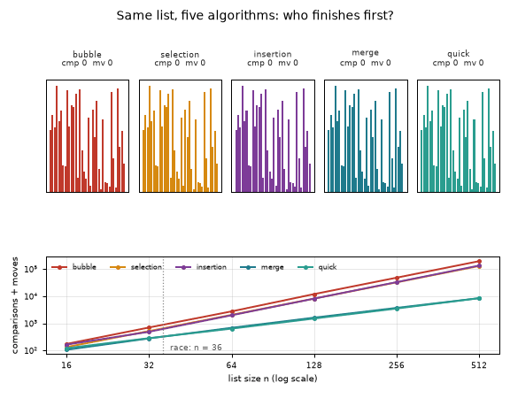
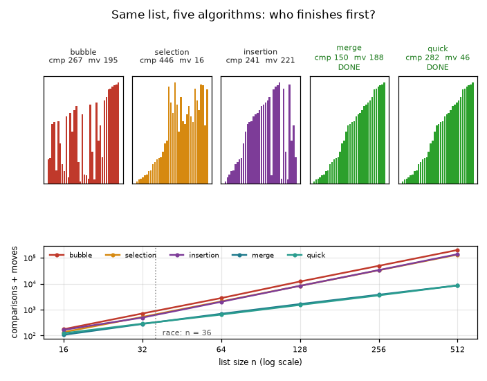
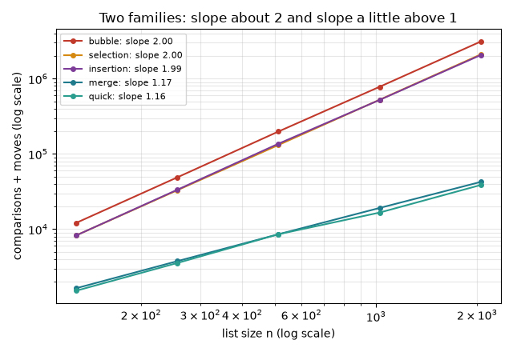
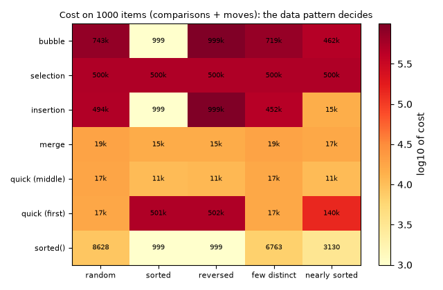
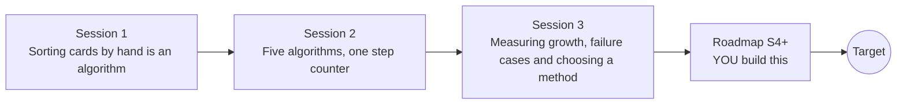

# opensorting

[](https://github.com/KrunalPanchal1995/opensorting/actions/workflows/ci.yml)   [](https://colab.research.google.com/github/KrunalPanchal1995/opensorting/blob/main/sessions/session-01/lesson.ipynb) [](https://krunalpanchal1995.github.io/opensorting/)

**Race sorting algorithms and count every comparison, swap and second, in three sessions.**

opensorting teaches how to compare sorting algorithms honestly, by counting comparisons and swaps, fitting growth curves and choosing a method for a data pattern, using only Python.

- **Start from zero.** Session 1 needs only a pack of cards and counting; no algorithm theory is assumed.
- **Count, do not guess.** Every claim is backed by operation counts, so the results do not depend on your computer.
- **Know you got it right.** Each session ends with a checkpoint that prints PASS or FAIL against hand calculations and a trusted reference.
- **Build the missing half.** The repo stops at Session 3 on purpose; the roadmap shows the path to the Target race.

[Target](#the-target) · [Who is this for](#who-is-this-for) · [Quick start](#quick-start) · [Sessions](#sessions) · [Roadmap](#roadmap) · [Contribute](#contribute) · [Explainer PDF](docs/explainer.pdf)

> **This repo is incomplete on purpose.** Sessions 1 to 3 are here and fully working. The finished Target below is a preview of what the community can build next. We show you the path, not the code. Sessions 4 and up are yours.

## The Target

Five sorting algorithms receive the same shuffled list and race, drawn as bars, each with live counters for comparisons and moves. The slow methods are still shuffling bars long after merge sort and quicksort have finished. Beside the race, a log-log plot shows how each method's cost grows with the list size. Your goal over the coming sessions: build that race yourself, from the counters of Session 2 to the growth curves of Session 3.



*Target: five algorithms race on the same shuffled list, with live comparison and move counters and a growth plot*



*Target, one frame: who is finished, who is still shuffling, and the scaling plot*



*Why the race is so lopsided: cost against list size on log-log axes, with fitted slopes*



*The best method depends on the data pattern: cost of each method on five kinds of input*

Try it live:

- [Math Visual Studio (Studio home)](https://krunalpanchal1995.github.io/studio/)

How the Target was made is shown only as a path in [promo/roadmap.md](promo/roadmap.md).

## Who is this for
**secondary school to diploma / undergraduate (levels 3-5).** Topic area: Computer Science, Programming and Software.

Prerequisites:

- Python 3.10 or newer; if `python --version` works, you are ready. PRIMER.md explains the rest.
- Lists, loops and if-statements in Python (a few hours of practice is enough).
- Session 3 uses logarithms: knowing that log2(1024) = 10 is enough, and Section B explains the rest.

New to Python? Read [PRIMER.md](PRIMER.md) first (10 minutes).

## Quick start

No installation knowledge needed. You need [Git](https://git-scm.com/downloads) and [Python 3.10+](https://www.python.org/downloads/) (Windows: tick "Add Python to PATH"). On Mac and Linux type `python3` wherever this page says `python`.

```bash
git clone https://github.com/KrunalPanchal1995/opensorting.git
cd opensorting
python start.py 1
```

`start.py` creates a private environment, installs what is needed and runs Session 1 with its checkpoint. Next: `python start.py 2`, `python start.py 3`, or `python start.py test` to check everything. Only a checkpoint: `python start.py check 1`.

Three lines show the whole idea of the repo: the number of steps, not the answer, separates the algorithms (they work as they are): Save it as `try.py` and run it with `python start.py run try.py` (this uses the private environment, where NumPy is installed):

```python
import numpy as np
n = 1000                                     # sort 1000 items
print(n * (n - 1) // 2, round(n * np.log2(n)))   # -> 499500 9966: quadratic steps versus n log2 n steps
```

Every session also opens in your browser with sliders (no install): [live apps](https://krunalpanchal1995.github.io/opensorting/). Or use the Colab badge above for the notebook.

## Sessions

| # | Session | Model level | Time | Live app |
|---|---|---|---|---|
| 1 | [Sorting cards by hand is an algorithm](sessions/session-01/README.md) | Level 1: conceptual interactive model | 60 min | [open](https://krunalpanchal1995.github.io/opensorting/session-01/) |
| 2 | [Five algorithms, one step counter](sessions/session-02/README.md) | Level 2: mathematical engineering model | 80 min | [open](https://krunalpanchal1995.github.io/opensorting/session-02/) |
| 3 | [Measuring growth, failure cases and choosing a method](sessions/session-03/README.md) | Level 3: simulation and validation | 90 min | [open](https://krunalpanchal1995.github.io/opensorting/session-03/) |

Each session follows the same six steps: A real-world problem, B concept and theory, C visual explanation, D interactive simulation, E worked example and experiment, F assessment and design challenge. Each ends with `checkpoint.py`, which prints `PASS` or `FAIL` against reference numbers. Session 3 also contains the real-world mini-project: **Choose a sorting method for a nearly sorted data feed**.

## Architecture



| Folder or file | What is inside |
|---|---|
| `sessions/` | three sessions: README (A-F), `lesson.py`, notebook, live app, exercises, activity sheet, checkpoint |
| `promo/` | the Target: media, live links, and the roadmap (path only) |
| `docs/` | `explainer.tex` and the built `explainer.pdf` |
| `tests/` | runs every lesson and checkpoint headless |
| `start.py` | one command to set up and run anything |
| `QUALITY.md`, `RUBRIC.md` | the quality checklist and the scoring rubric |
| `.github/` | CI, PDF build, Pages deploy, issue and PR templates |

## Roadmap

| Milestone | What you will build | Difficulty |
|---|---|---|
| Session 4: Run-detecting merge sort | A natural merge sort that splits the list into runs and merges them, with the same counters. | intermediate |
| Session 5: Three-way quicksort | A quicksort variant with a three-way partition and the same counters. | intermediate |
| Session 6: A quicksort with no bad input | A sort that never exceeds twice n log2 n comparisons on any of the five patterns. | advanced |
| Session 7: Beat the comparison limit | A counting sort for integers in a small range, measured with the same step counter. | advanced |
| Session 8: The live race | An animation that replays several sorts on the same list with live counters. | intermediate |

Full detail with a checkpoint per milestone: [promo/roadmap.md](promo/roadmap.md).

## Contribute
New to GitHub? Read [CONTRIBUTING.md](CONTRIBUTING.md); it starts from zero. Pick an issue labelled `good first issue`. Translations into Hindi, Telugu, Tamil and Malayalam are welcome.

<details>
<summary>Development</summary>

```bash
python start.py test        # runs every lesson and checkpoint
```
Lessons use `# %%` cell markers so they open as notebooks in VS Code. See [QUALITY.md](QUALITY.md) for the standard every session meets.
</details>

## License
MIT. See [LICENSE](LICENSE). Media in `promo/media` is (c) Krunal Panchal, CC BY 4.0.

## Acknowledgments
Part of the [PAN IIT OSS](https://hellofoss.tech-iitb.org/projects) open-source teaching collection, modelled on the structure of [openspline](https://github.com/openspline/openspline). Built on ideas from the Math Visual Studio at https://krunalpanchal1995.github.io/studio/.
