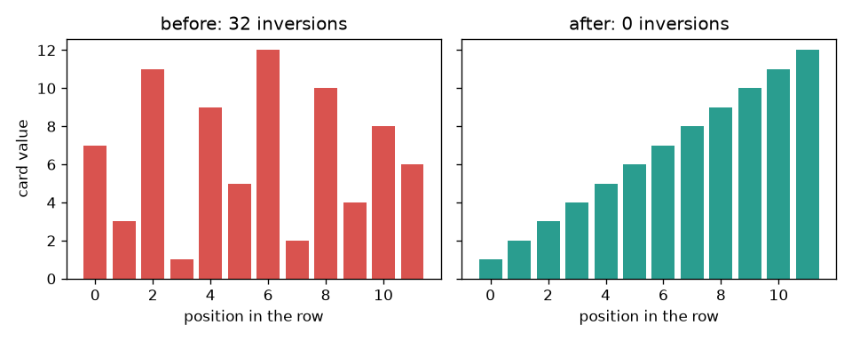
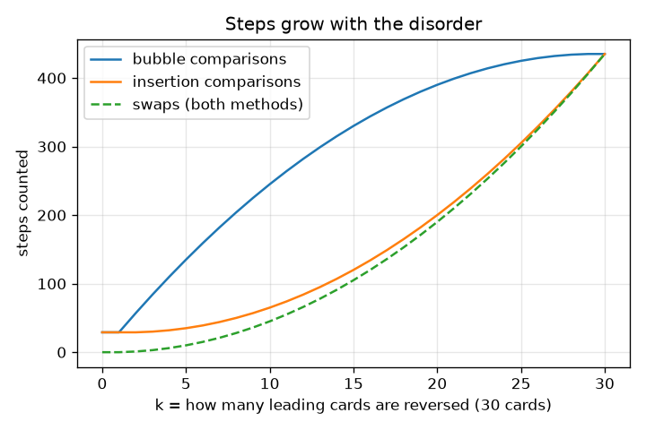

# Session 1: Sorting cards by hand is an algorithm

*Level 1 (conceptual interactive model) · about 60 minutes · opensorting*

> This is a simplified educational model. It is not a validated design tool and must not be used for real structures, electrical installations, vehicles, industrial processes or medical decisions.

**Prerequisites**

- Counting and comparing numbers.
- You have read PRIMER.md and run `python start.py 1` once.

**Learning objectives.** After this session you can:

- Describe bubble sort and insertion sort as step-by-step rules anyone could follow.
- Count comparisons and swaps for a small row of cards by hand and in Python.
- Explain why the number of swaps equals the number of pairs in the wrong order.
- Read a bar picture and a graph of steps against how mixed up the row is.

## A. Real-world problem
You are dealt five cards and put them in order without thinking about it. A computer cannot think, so it needs the rules written down exactly. Two rule sets are easy to follow: look at neighbours and swap them if they are in the wrong order (bubble sort), or take each new card and slide it left until it fits (insertion sort). Both give the same sorted row. Do they take the same number of steps? And does it depend on how mixed up the cards were at the start?

## B. Concept and theory
A row of n cards is sorted when every card is not bigger than the card to its right. A comparison looks at two cards. A swap exchanges two neighbours. Bubble sort walks along the row swapping neighbours that are in the wrong order, so the biggest card bubbles to the end; it repeats on the shorter row that is left, and stops early after a walk with no swap. Insertion sort takes the next card and slides it left one place at a time past every bigger card. An inversion is a pair of cards where the bigger one is to the left of the smaller one. A swap of two neighbours removes exactly one inversion, so both methods use as many swaps as there are inversions at the start. A sorted row has 0 inversions; a reversed row of n cards has n(n-1)/2, the most possible.

| Symbol | Meaning | Unit |
|---|---|---|
| n | number of cards in the row | cards |
| k | number of leading cards that start reversed | cards |
| comparisons | times two cards were looked at | count |
| swaps | times two neighbours were exchanged | count |
| inversions | pairs of cards in the wrong order | count |

**Assumptions**

- Cards are numbers and can be compared with less-than.
- A swap moves two neighbouring cards only (one place).
- Every comparison and every swap counts as one step, whatever it costs a real computer.
- This is a simplified educational model of how fast sorting is.

$$ \text{swaps}=\text{inversions}=\#\{(i,j):\ i<j,\ a_i>a_j\} $$

$$ \text{inversions of a reversed row}=\frac{n(n-1)}{2} $$

$$ \text{bubble sort on a sorted row: } n-1 \text{ comparisons, } 0 \text{ swaps} $$

## C. Visual explanation
The left figure shows a row of 12 cards as bars before and after sorting: the shuffled row has 32 pairs in the wrong order and the sorted row has none. The right figure plots the steps counted for a row of 30 cards as more and more of its front is reversed. The swap curve (the same for both methods) rises smoothly; bubble sort's comparisons stay far above insertion sort's until the whole row is reversed, where both reach 435.

*A row of 12 cards as bars: 32 pairs in the wrong order before, none after.*

*Steps counted for 30 cards as more of the front is reversed: swaps are the same for both methods, comparisons are not.*

## D. Interactive simulation
Run the lesson (`python start.py 1`), then open the live app: [Session 1: sort a row of cards](https://krunalpanchal1995.github.io/opensorting/session-01/) (or `app.html` in this folder). Move the sliders to change the number of cards and how much of the row starts mixed up. Watch the bars turn from green (in the right place) to red, then open the steps graph and compare the two methods.

**Challenge.** Make the two methods need more than 400 swaps.

## E. Worked example and experiment
**Problem.** Sort the cards 5 2 4 1 3 with bubble sort and with insertion sort. Count comparisons and swaps for each, and check against the number of pairs in the wrong order.

1. Pairs in the wrong order: (5,2), (5,4), (5,1), (5,3), (2,1), (4,1), (4,3), so 7 inversions. Both methods must use 7 swaps.
2. Bubble walk 1 compares (5,2) swap, (5,4) swap, (5,1) swap, (5,3) swap: 4 comparisons, 4 swaps, row 2 4 1 3 5.
3. Bubble walk 2 compares (2,4) no swap, (4,1) swap, (4,3) swap: 3 comparisons, 2 swaps, row 2 1 3 4 5. Walk 3 compares (2,1) swap, (2,3) no swap: 2 comparisons, 1 swap, row 1 2 3 4 5. Walk 4 compares (1,2): 1 comparison, no swap, so it stops. Total 4 + 3 + 2 + 1 = 10 comparisons and 4 + 2 + 1 = 7 swaps.
4. Insertion sort: the 2 passes 1 comparison (swap); the 4 needs 2 comparisons (one swap); the 1 slides past 5, 4 and 2 (3 comparisons, 3 swaps); the 3 slides past 5 and 4 and stops at 2 (3 comparisons, 2 swaps). Total 1 + 2 + 3 + 3 = 9 comparisons and 1 + 1 + 3 + 2 = 7 swaps.

**Answer.** Bubble sort: 10 comparisons and 7 swaps. Insertion sort: 9 comparisons and 7 swaps. Both swap counts equal the 7 inversions.

**Experiment.** Deal five real cards, write the numbers 5 2 4 1 3 on them and sort them with each rule, counting out loud. You should get 10 and 9 comparisons. A person usually does fewer comparisons because the eye sees the whole row at once. The model counts only the steps of a strict rule; a human uses shortcuts the program cannot.

## F. Assessment and design challenge
**Question type A: Conceptual.** Why do bubble sort and insertion sort need exactly the same number of swaps for the cards 5 2 4 1 3, even though they work differently?

Hint

Think about what one swap of two neighbours does to the pairs that are in the wrong order.

Step-by-step solution

A swap of two neighbouring cards changes the order of that one pair only, and when the left card is bigger it fixes that pair. So every swap removes exactly one pair in the wrong order. The row 5 2 4 1 3 starts with 7 such pairs and ends with none, so any method that only swaps neighbours needs exactly 7 swaps. The methods differ only in how many comparisons they waste (10 for bubble sort, 9 for insertion sort).

**Question type B: Numerical.** A row of 30 cards is completely reversed (30 down to 1). How many comparisons and swaps does insertion sort need? Check your answer with a formula.

Hint

Every pair is in the wrong order. How many pairs are there among 30 cards?

Step-by-step solution

The number of pairs among 30 cards is 30 * 29 / 2 = 435. All of them are in the wrong order, so 435 swaps are needed, and insertion sort compares every card with every card on its left, so there are 435 comparisons as well. Units: counts of steps. Sanity check: a sorted row of 30 needs only 29 comparisons, so 435 is much larger, as it should be for the worst case.

**Question type C: Graph and simulation interpretation.** In the steps graph for 30 cards, at k = 10 (the first 10 cards reversed), which method needs fewer comparisons and by how many? How many swaps do they need?

Hint

Read the red and blue curves at k = 10. The swap curve is the same for both.

Step-by-step solution

Bubble sort needs 245 comparisons and insertion sort 65, so insertion sort needs 180 fewer. Both need 45 swaps = 10 * 9 / 2, the number of pairs in the wrong order. Insertion sort wins because the part of the row that is already in order is passed by with one comparison per card, while bubble sort still walks through it again and again.

**Question type D: Design and optimisation challenge.** Design: a teacher hands you 30 cards that are sorted except that the first 20 are in reverse order. You must pick bubble sort or insertion sort and tell the class how many comparisons to expect. Which do you pick and why? What would you pick if the cards were already sorted?

Hint

Use the pattern 'first 20 reversed' and compare comparisons for the two methods; for the second part count comparisons on a sorted row.

Step-by-step solution

With the first 20 of 30 cards reversed there are 20 * 19 / 2 = 190 pairs in the wrong order, so both methods swap 190 times. Bubble sort needs 390 comparisons and insertion sort 200, so choose insertion sort: about half the work. For an already sorted row both need only 29 comparisons and no swaps, so the choice does not matter. Trade-off: both are fine for 30 cards, but the counts grow with the square of the number of cards, which Session 2 explains.

Score yourself with [RUBRIC.md](../../RUBRIC.md). Print the [activity sheet](activity_sheet.md) to work on paper.

## Common misconceptions
| Common misconception | What is actually true |
|---|---|
| Sorting a row always takes the same number of steps. | The steps depend on how mixed up the row is at the start: a sorted row of 30 cards needs 29 comparisons, a reversed one 435. |
| Two algorithms that give the same sorted answer must take the same time. | The answer is the same but the number of steps can differ a lot. That difference is what this repo measures. |
| Fewer swaps always means less work. | Comparisons count too, and bubble and insertion sort make the same swaps but a different number of comparisons. |
| Bubble sort is the best way to sort because it is the simplest. | It is the simplest to describe, but it often needs more comparisons than insertion sort on the same row. |

## Glossary
- **algorithm**: a list of exact steps that solves a problem
- **comparison**: looking at two items to decide which is bigger
- **swap**: exchanging the positions of two items
- **inversion**: a pair of items where the bigger one is to the left
- **bubble sort**: repeatedly swap neighbours that are in the wrong order
- **insertion sort**: slide each new item left until it fits among the sorted ones before it

## Finish
1. Do the three coding tasks in [exercises.md](exercises.md).
2. Run `python start.py 1` again after your changes. It ends with the checkpoint; when it prints `PASS`, you are done. (Checkpoint only: `python start.py check 1`.)

Next: [Session 2](../session-02/README.md)
