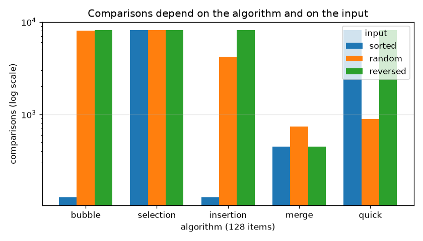
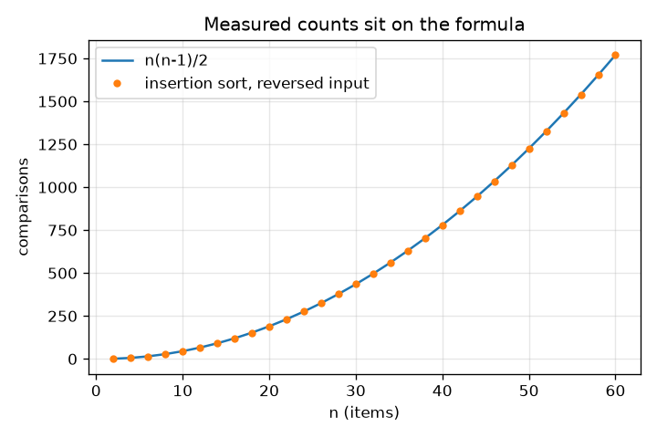

# Session 2: Five algorithms, one step counter

*Level 2 (mathematical engineering model) · about 80 minutes · opensorting*

> This is a simplified educational model. It is not a validated design tool and must not be used for real structures, electrical installations, vehicles, industrial processes or medical decisions.

**Prerequisites**

- Session 1: comparisons, swaps and inversions.
- Python functions, lists and loops. Logarithms are explained in Section B.

**Learning objectives.** After this session you can:

- Write bubble, selection, insertion, merge and quick sort in plain Python with a comparison and move counter.
- Test that a sort is correct: ordered output, same items, input unchanged.
- Measure best, average and worst-case inputs and match the counts to n(n-1)/2 and n log2 n.
- Explain why n log2 n beats n(n-1)/2 for large n, and test whether a sort is stable.

## A. Real-world problem
A shop has 1,000,000 orders to put in date order. Two programs give exactly the same sorted answer, yet one finishes in a fraction of a second and the other keeps the computer busy for minutes. Why can a more efficient algorithm perform so much better on a large dataset even when both give the same answer? The answer is the number of steps each one takes, and how fast that number grows when the list grows.

## B. Concept and theory
We count steps instead of seconds, because seconds depend on the computer. Bubble, selection and insertion sort compare many pairs of items: in the worst case about n(n-1)/2 comparisons, which grows with the square of n. Merge sort splits the list in halves, sorts each half and merges them; there are about log2 n levels of splitting and each level touches n items, so about n log2 n steps. Quicksort picks a pivot and splits the items into smaller and larger ones; with good pivots it also takes about n log2 n steps. For n = 1000 items the two formulas give 499,500 and 9,966, and the gap widens as n grows. Insertion sort is special: its work is about n - 1 comparisons plus the number of inversions, so it is nearly linear on nearly sorted data. A sort is stable if items with equal keys stay in their original order.

| Symbol | Meaning | Unit |
|---|---|---|
| n | number of items to sort | items |
| C | number of comparisons | count |
| M | number of moves (swaps, shifts or copies) | count |
| log2 n | how many times n can be halved until 1 remains | no unit |
| key | the value the items are sorted by | any comparable value |

**Assumptions**

- Every comparison and move costs one step; real computers differ (memory, caches, interpreter).
- Counts are for items that can be compared with less-than.
- 'Average' means the mean over 20 random shuffles of distinct items.
- A speed of 1 billion (1e9) steps per second is an assumed figure, not a measurement of any real machine.
- This is a simplified educational model of running time.

$$ C_{\text{insertion}}(\text{reversed list})=M_{\text{insertion}}=\frac{n(n-1)}{2} $$

$$ \frac{n}{2}\log_2 n\ \le\ C_{\text{merge}}\ \le\ n\log_2 n-n+1 $$

$$ \frac{n(n-1)/2}{n\log_2 n}\approx\frac{n}{2\log_2 n} $$

$$ C_{\text{insertion}}=M_{\text{insertion}}+(\text{items that do not slide all the way left})\ \le\ \text{inversions}+n-1 $$

## C. Visual explanation
The first figure shows the comparisons of the five methods on sorted, random and reversed lists of 128 items on a log scale. Selection sort has the same bar height for all three inputs; bubble and insertion sort have a tiny bar on sorted input and a huge bar on reversed input; merge sort stays low everywhere. The second figure shows insertion sort's measured comparisons on reversed lists sitting exactly on the curve n(n-1)/2.

*Comparisons of the five methods on sorted, random and reversed lists of 128 items (log scale).*

*Insertion sort on reversed lists: measured comparisons sit exactly on n(n-1)/2.*

## D. Interactive simulation
Run the lesson (`python start.py 2`), then open the live app: [Session 2: n squared against n log n](https://krunalpanchal1995.github.io/opensorting/session-02/) (or `app.html` in this folder). Move the size slider (n = 10 to the power x) and the speed slider. Watch the two step counts and the time each would need, then switch to the growth graph and see the gap between the red and blue curves widen.

**Challenge.** Find a list size where the n(n-1)/2 method would need more than a minute at the chosen speed.

## E. Worked example and experiment
**Problem.** A list has n = 1,000,000 items. Compare n(n-1)/2 comparisons with n log2 n comparisons. How many times more is the first? How long does each take at 1 billion steps per second?

1. n(n-1)/2 = 1,000,000 * 999,999 / 2 = 499,999,500,000 comparisons, about 5.0e11.
2. log2 1,000,000 = 19.93, so n log2 n = 19,931,569 comparisons, about 2.0e7.
3. Ratio = 499,999,500,000 / 19,931,569 = 25,086, about 25,000 times more.
4. At 1e9 steps per second: 499,999,500,000 / 1e9 = 500 seconds, about 8 minutes; 19,931,569 / 1e9 = 0.0199 seconds, about 0.02 seconds.

**Answer.** About 5.0e11 versus 2.0e7 comparisons, a ratio of about 25,086, which is 500 seconds against 0.02 seconds at 1e9 steps per second.

**Experiment.** Time Python's own sorted() on a list of 100,000 shuffled numbers and on 1,000,000 shuffled numbers with a stopwatch or time.perf_counter(). The time grows by roughly 10 to 20 times, close to what n log n predicts, and not by 100 times. Real timings also include memory effects and interpreter overhead, so they will not match the step counts exactly; that is why this repo uses counts for its main claims.

## F. Assessment and design challenge
**Question type A: Conceptual.** Two programs sort the same 1,000,000 records and give identical answers. Why can the more efficient algorithm be hugely faster on this large dataset, even though both are correct?

Hint

Compare how the number of steps grows when n grows: n squared versus n log2 n.

Step-by-step solution

Correctness only says what comes out, not how many steps it took. A method with about n(n-1)/2 comparisons needs about 5.0e11 steps for 1,000,000 records; a method with about n log2 n needs about 2.0e7, which is about 25,086 times fewer. On a small list (say 10 items) the difference is a few dozen steps and nobody notices, but because one count grows with n squared and the other with n log2 n, the gap widens as the dataset grows. At 1e9 steps per second that is 500 seconds against 0.02 seconds.

**Question type B: Numerical.** Predict how many comparisons insertion sort needs on a reversed list of 100 items, and how many item shifts. Then say what the answer would be for a sorted list of 100 items.

Hint

Every item must slide past every item before it. Use n(n-1)/2.

Step-by-step solution

For n = 100: 100 * 99 / 2 = 4950 comparisons and 4950 shifts (the code gives exactly 4950 and 4950). For a sorted list each item needs one comparison and no shift, so n - 1 = 99 comparisons and 0 shifts. Units: counts of steps. Sanity check: 4950 is about n squared / 2 = 5000.

**Question type C: Graph and simulation interpretation.** In the bar figure for 128 items, selection sort has the same height for sorted, random and reversed input, while insertion sort does not. Explain this, and give the numbers for n = 1000 sorted and reversed.

Hint

Selection sort always scans the whole unsorted part to find the smallest item. Insertion sort stops sliding as soon as the item fits.

Step-by-step solution

Selection sort compares every item with all the items that remain, whatever their order, so it always does n(n-1)/2 comparisons: 499,500 for n = 1000 on any input. Insertion sort stops as soon as the card fits, so on a sorted list it does n - 1 = 999 comparisons and on a reversed list n(n-1)/2 = 499,500. The input order matters for insertion sort and not for selection sort.

**Question type D: Design and optimisation challenge.** Design: a log file of 1000 lines is nearly sorted by time, with 10 neighbouring lines swapped at random. Choose between insertion sort, merge sort and quick sort (first item as pivot) and justify your choice with step counts.

Hint

Count the inversions with `inversions`, then compare the comparisons of the three sorts on `nearly_sorted(1000, 10)`.

Step-by-step solution

The list has only 28 pairs in the wrong order. Insertion sort needs (n - 1) + 28 = 1027 comparisons, merge sort needs 4947, more than 4 times as many, and quick sort with a first-item pivot needs over 400,000 because sorted-looking data is its worst case. Choose insertion sort. Trade-off: if the data were random or reversed, insertion sort would need about n(n-1)/2 = 499,500 steps on reversed input and merge sort would be the better choice. Another trade-off: insertion sort and merge sort are stable, which matters if lines with equal timestamps must keep their order.

Score yourself with [RUBRIC.md](../../RUBRIC.md). Print the [activity sheet](activity_sheet.md) to work on paper.

## Common misconceptions
| Common misconception | What is actually true |
|---|---|
| Merge sort is always faster than insertion sort. | On a nearly sorted list of 1000 items insertion sort needs 1027 comparisons and merge sort 4947. The best method depends on the data. |
| A fast sort is only about time, not about correctness. | A sort must produce an ordered list with exactly the same items; the tests check both, and also that the input is unchanged. |
| Quick sort is always n log n. | With the first item as pivot, a sorted list makes it do n(n-1)/2 comparisons; Session 3 shows the fixes. |
| All sorts are stable. | Bubble, insertion and merge sort are stable; selection sort and this quick sort are not. |
| n log n and n squared are about the same for big n. | At n = 1,000,000 they differ by a factor of about 25,000. |

## Glossary
- **worst case**: the input on which an algorithm takes the most steps
- **best case**: the input on which it takes the fewest steps
- **stable sort**: a sort that keeps items with equal keys in their original order
- **pivot**: the item quick sort compares everything else against
- **log2 n**: the number of times n can be halved; log2 1024 = 10
- **inversion**: a pair in the wrong order; insertion sort does about n - 1 plus this many comparisons

## Finish
1. Do the three coding tasks in [exercises.md](exercises.md).
2. Run `python start.py 2` again after your changes. It ends with the checkpoint; when it prints `PASS`, you are done. (Checkpoint only: `python start.py check 2`.)

Next: [Session 3](../session-03/README.md)
