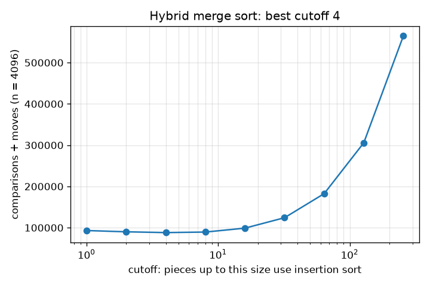
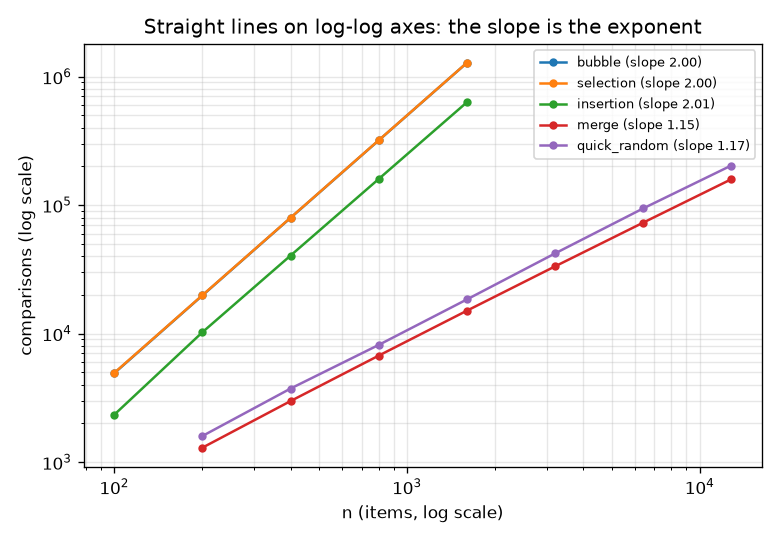
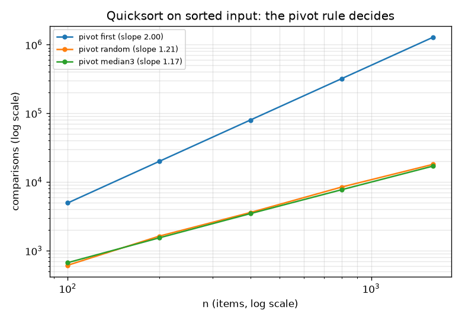

# Session 3: Measuring growth, failure cases and choosing a method

*Level 3 (simulation and validation) · about 90 minutes · opensorting*

> This is a simplified educational model. It is not a validated design tool and must not be used for real structures, electrical installations, vehicles, industrial processes or medical decisions.

**Prerequisites**

- Session 2: counters, n(n-1)/2 and n log2 n.
- Logarithms: log2 1024 = 10; a straight line y = m x + c.

**Learning objectives.** After this session you can:

- Fit slopes on log-log axes to measure how the cost of a sort grows with n.
- Explain and demonstrate quicksort's worst case, and compare three pivot rules.
- Build a hybrid merge/insertion sort and find the best cutoff and the cross-over size.
- Compare with Python's built-in sorted(), check memory use, and handle two failure cases.
- Choose and justify a sorting method for a data pattern from measurements.

## A. Real-world problem
A textbook says 'merge sort is n log n'. A colleague says 'quicksort is faster'. A third says 'Python's sorted() beats both'. Who is right depends on your data. To decide, you measure: count operations over a range of sizes, fit growth curves, try sorted, reversed, duplicate-heavy and nearly sorted inputs, look for the input that breaks each method, and justify your choice. This is how engineers choose a sorting method for a real data feed.

## B. Concept and theory
If the cost grows like a power, cost = a * n^p, then taking logarithms gives log(cost) = log(a) + p log(n), a straight line whose slope is the exponent p. We fit that line to operation counts measured for several sizes. We expect slope about 2 for bubble, selection and insertion sort. For n log n the local slope is 1 + 1/ln n, a little above 1 (about 1.14 near n = 1600), so we expect values such as 1.1 to 1.2, not exactly 1. Quicksort with the first item as pivot on sorted input splits off one item at a time, so it does n(n-1)/2 comparisons and recurses n - 1 levels deep; choosing the pivot at random or as the median of the first, middle and last item avoids that case, but no simple rule is safe for every pattern. A hybrid merge sort sorts small pieces with insertion sort, which has less overhead on tiny lists. Merge sort needs extra space of order n for the merged lists; insertion, selection and bubble sort need almost none. Python's sorted() uses Timsort, which is known to find runs that are already ascending or descending: on presorted input it needs only n - 1 comparisons. We check all of this by measurement, with counts for the main claims and wall-clock times only as illustration.

| Symbol | Meaning | Unit |
|---|---|---|
| n | number of items | items |
| p | growth exponent: slope of log cost against log n | no unit |
| a | constant factor of the cost | steps |
| cutoff | piece size at or below which the hybrid uses insertion sort | items |
| depth | number of nested pieces in quicksort's recursion | levels |
| k | number of random swaps applied to a sorted list | swaps |

**Assumptions**

- Cost means comparisons plus moves, each one step.
- Inputs are generated with fixed random seeds so every number is reproducible.
- Wall-clock times depend on the computer; they are shown only to illustrate and the checks use generous margins.
- Python's Timsort behaviour is stated as known behaviour and then verified by counting comparisons.
- This is a simplified educational model, not a benchmark of a production system.

$$ \text{cost}=a\,n^{p}\ \Longrightarrow\ \log(\text{cost})=\log a+p\,\log n $$

$$ p=\frac{d\ln(n\ln n)}{d\ln n}=1+\frac{1}{\ln n} $$

$$ C_{\text{quick, first pivot, sorted input}}=\frac{n(n-1)}{2},\qquad \text{depth}=n-1 $$

$$ C_{\text{timsort}}(\text{presorted})=n-1 $$

## C. Visual explanation
The first figure plots comparisons against n on log-log axes for five methods. Bubble, selection and insertion sort fall on lines of slope about 2; merge sort and quicksort with a random pivot fall on lines of slope about 1.15, far below them at large n. The second figure shows quicksort on sorted input with three pivot rules: the first-item pivot has slope about 2 while the random and median-of-three pivots stay near n log n. The third figure plots the cost of the hybrid merge sort against the cutoff: it dips at small cutoffs and then rises steeply as insertion sort handles bigger pieces.

*Cost of hybrid merge sort against the cutoff for 4096 random items: lowest at a cutoff of 4.*

*Comparisons against n on log-log axes: slopes of about 2 for the three simple sorts and about 1.15 for merge sort and random-pivot quicksort.*

*Quicksort on sorted input with three pivot rules: the first item is quadratic, random and median-of-three stay near n log n.*

## D. Interactive simulation
Run the lesson (`python start.py 3`), then open the live app: [Session 3: quicksort on sorted input](https://krunalpanchal1995.github.io/opensorting/session-03/) (or `app.html` in this folder). Slide the number of items and switch the pivot rule between the first item and the median of three. Watch the recursion-level bars on sorted input, then open the growth graph and compare the two curves with the grey n log2 n curve.

**Challenge.** Switch to the pivot rule that keeps quicksort fast on sorted input, with at least 400 items.

## E. Worked example and experiment
**Problem.** Quicksort a sorted list of 200 items with three pivot rules: the first item, the median of three, and a random item (seed 0). Compare comparisons and recursion depth with n(n-1)/2.

1. With the first item as pivot, each partition splits off one item. The comparisons are 199 + 198 + ... + 1 = 200 * 199 / 2 = 19,900 and the recursion is 199 levels deep.
2. With the median of three, the pivot is the middle value, so the pieces halve. The code counts 1,534 comparisons (including the 3 used for each pivot choice) and a depth of 7.
3. With a random pivot (seed 0) the code counts 1,625 comparisons and a depth of 16.
4. Compare: 19,900 / 1,534 is about 13 times more comparisons for the first-item pivot, and the gap widens as n grows because n(n-1)/2 grows with the square of n.

**Answer.** First item: 19,900 comparisons, depth 199. Median of three: 1,534 comparisons, depth 7. Random pivot: 1,625 comparisons, depth 16.

**Experiment.** Sort a sorted list of 2000 numbers with a recursive quicksort that picks the first item as pivot, with Python's recursion limit left at its default, and see the RecursionError. Then try the median-of-three pivot. In practice libraries avoid both problems by switching strategies; a model that counts only comparisons ignores that deep recursion needs memory (stack space) and can crash.

## Real-world application and mini-project: Choose a sorting method for a nearly sorted data feed
A feed delivers 2000 records that are already in time order, except that a few records arrived out of place (modelled as random swaps of two positions anywhere in the list). The team wants the method with the lowest cost (comparisons plus moves) and a rule for when to switch. Use `far_nearly_sorted`, `cost`, `merge_sort` and `crossover_swaps` from Session 3 to measure insertion sort, merge sort and a hybrid with cutoff 4 for 0, 2, 5, 10, 11, 12, 20, 50 and 100 swaps, and find the number of swaps at which each merge variant first becomes cheaper than insertion sort.

**Deliverable:** A script that prints a table of cost against the number of swaps for the three methods, reports the two cross-over values, saves a log-scale plot, and ends with a one-paragraph recommendation that uses your measurements.

**Success looks like:** The script reports that pure merge sort first beats insertion sort at 11 swaps and the hybrid (cutoff 4) at 10 swaps, and that with only 2 swaps insertion sort costs 5,923, more than 4 times less than the hybrid (29,384). The recommendation says: insertion sort below about 10 out-of-place records in 2000, a hybrid merge sort above.

## F. Assessment and design challenge
**Question type A: Conceptual.** Why is a sorted list the worst case for quicksort with the first item as pivot, and why does that also create a risk of crashing, not just of being slow?

Hint

What are the sizes of the two pieces after one partition when the pivot is the smallest item?

Step-by-step solution

On sorted input the first item is the smallest, so one piece is empty and the other has n - 1 items. Every level removes just one item, so there are n - 1 levels and n(n-1)/2 comparisons in total (19,900 for 200 items). Recursion depth n - 1 uses one stack frame per level, and Python stops with a RecursionError at its default limit: the checkpoint shows that 1000 sorted items fail with a first-item pivot while the median-of-three pivot succeeds.

**Question type B: Numerical.** The comparisons for insertion sort on a reversed list are 4950 for n = 100 and 19,900 for n = 200. Compute the log-log slope between these two points and say what it tells you.

Hint

slope = log2(19,900 / 4950), because n doubled.

Step-by-step solution

19,900 / 4950 = 4.02, and log2 4.02 = 2.007. The slope is about 2, so the cost grows with the square of n: doubling n multiplies the cost by about 4. Sanity check: n(n-1)/2 is slightly less than n squared / 2, so a slope a little above or below 2 is expected.

**Question type C: Graph and simulation interpretation.** On the log-log figure, which lines are parallel, what are their approximate slopes, and what does the gap between the two groups of lines mean?

Hint

Bubble, selection and insertion sort are one group; merge sort and random-pivot quicksort are the other. Use the legend.

Step-by-step solution

Bubble, selection and insertion sort are nearly parallel with slopes between 1.9 and 2.1 (about 2). Merge sort and random-pivot quicksort are nearly parallel with slopes between 1.05 and 1.25 (about 1 plus a little, as 1 + 1/ln n predicts). On a log-log plot a vertical gap is a constant ratio, and because the slopes differ the gap widens: the steeper group costs more and more, relatively, at larger n.

**Question type D: Design and optimisation challenge.** Design: 1000 values contain only 10 distinct numbers (many duplicates). Choose among merge sort, quicksort with a first-item pivot and insertion sort, and justify your choice with costs. What does this tell you about the pivot rule?

Hint

Run `cost` for each method on `make_data('duplicates', 1000)`.

Step-by-step solution

Merge sort costs 18,516 (comparisons plus moves) and quicksort with a first-item pivot 57,190, over 3 times more; insertion sort costs hundreds of thousands. Choose merge sort. Quicksort with this partition rule sends all equal items to the same side, so with only 10 distinct values the pieces stop shrinking quickly (an input of 200 identical items costs 19,900 comparisons). A three-way partition fixes this, which is a roadmap milestone. Trade-off: merge sort needs extra memory of order n.

Score yourself with [RUBRIC.md](../../RUBRIC.md). Print the [activity sheet](activity_sheet.md) to work on paper.

## Common misconceptions
| Common misconception | What is actually true |
|---|---|
| Median-of-three removes quicksort's worst case. | It fixes sorted input, but on a reversed list of 1000 items it costs 190,506, more than 5 times a random pivot. No simple rule is safe for every pattern. |
| A slope of exactly 1 is needed for n log n. | The local slope of n log n is 1 + 1/ln n, about 1.14 near n = 1600, so a fitted slope of 1.1 to 1.2 is the right answer. |
| Timing a program once proves which algorithm is faster. | Wall-clock times vary with the machine and its load; operation counts do not. Time is a supporting illustration. |
| A hybrid with a bigger insertion cutoff is always better. | The cost is lowest at a small cutoff (4 for 4096 random items) and much worse at 64. |
| Python's sorted() is just another n log n sort. | It is also nearly linear on presorted input: 19,999 comparisons for 20,000 sorted items. |

## Glossary
- **log-log plot**: a plot with both axes on a log scale; a power law cost = a n^p becomes a straight line of slope p
- **hybrid sort**: a sort that switches method for small pieces, here from merge sort to insertion sort
- **cutoff**: the piece size at which a hybrid switches to insertion sort
- **Timsort**: the sort inside Python's sorted(); it finds runs in the data and merges them
- **recursion depth**: how many calls are nested inside each other at the deepest point
- **cross-over size**: the size at which one method starts to beat another

## Finish
1. Do the three coding tasks in [exercises.md](exercises.md).
2. Run `python start.py 3` again after your changes. It ends with the checkpoint; when it prints `PASS`, you are done. (Checkpoint only: `python start.py check 3`.)

Next: the [roadmap](../../promo/roadmap.md). Session 4 is yours to build.
